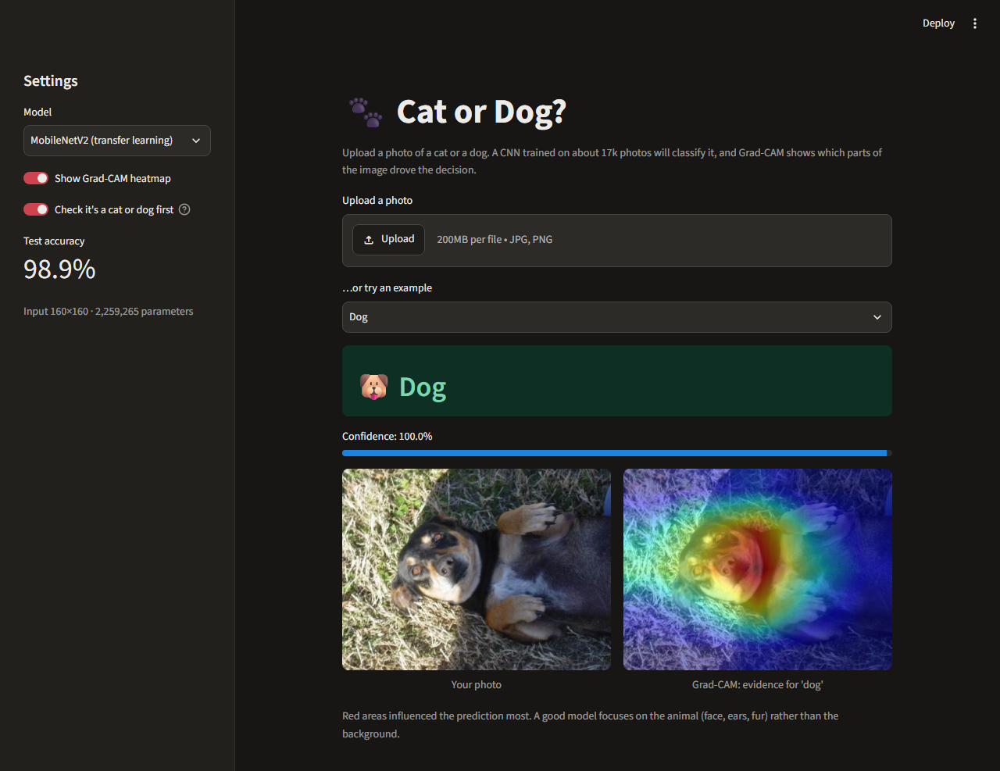
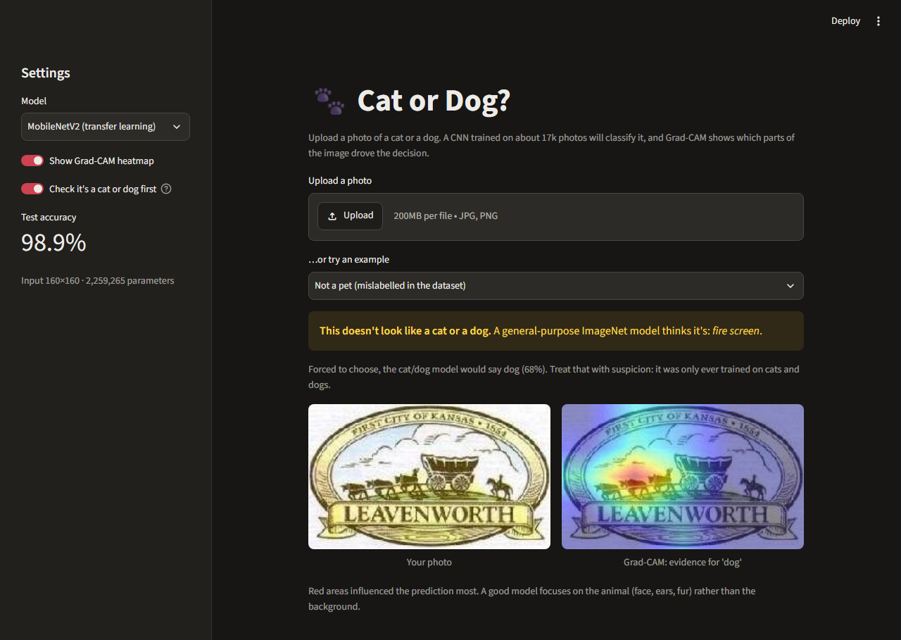
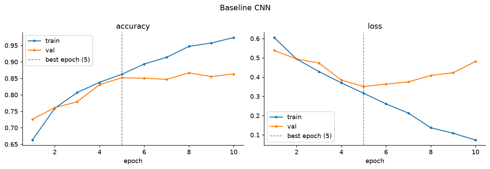
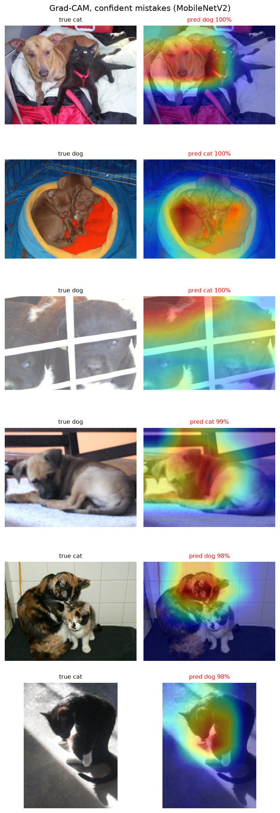

# Cats vs Dogs: Image Classification with CNNs

Three convolutional networks classify photos as **cat** or **dog**: a CNN trained from scratch, a
regularized CNN, and **MobileNetV2 transfer learning**. They're compared on a held-out test set, the
predictions are explained with **Grad-CAM**, and the best model is served in a **Streamlit app** that
also flags photos that aren't cats or dogs at all.

**▶ Live demo: [https://cats-vs-dogs-classifier-yashwanth.streamlit.app](https://cats-vs-dogs-classifier-yashwanth.streamlit.app)**: upload a photo or pick an example. A sleeping app takes about a minute to wake up.

| | |
|---|---|
|  |  |

## Results (test set, 3,715 images never used for training or tuning)

| Model | Test accuracy | Precision | Recall | F1 | ROC-AUC | Params | Epochs | Train time |
|---|---|---|---|---|---|---|---|---|
| Baseline CNN (scratch) | 84.6% | 0.836 | 0.859 | 0.848 | 0.919 | 4.29M | 10 | 23.6 min (CPU) |
| Improved CNN (BN + Dropout + augmentation) | 85.7% | 0.855 | 0.860 | 0.858 | 0.934 | 4.29M | 26 | 21.6 min (GPU) |
| **MobileNetV2 (transfer learning)** | **98.9%** | **0.988** | **0.990** | **0.989** | **0.999** | 2.26M (1.51M trainable) | 17 | 23.7 min (GPU) |

Exact values are in [`reports/comparison_table.csv`](reports/comparison_table.csv). Positive class = dog.

**Key findings**
- **Transfer learning wins by a wide margin.** MobileNetV2 with ImageNet weights reaches about 98% validation accuracy after one epoch, and fine-tuning the top 30 layers lifts it to 98.9% on test.
- **Regularization fixed overfitting more than accuracy.** The baseline reached 97% train vs 85% val (classic overfitting). The improved CNN keeps train and val within about 2 points and has lower validation loss, but gains only +1.1 points of test accuracy.
- **Grad-CAM shows why.** MobileNetV2 looks at the animal. The scratch CNNs often look at the background (cage bars, picture frames, carpet), so some of their accuracy comes from shortcut cues, not from recognizing cats and dogs.
- **The dataset has label noise.** Test image #2082 is labelled *dog* but is a town logo, and #277 (*cat*) shows a dog and a cat together. Some "errors" are labelling problems.

| Training curves (baseline: overfitting) | Grad-CAM (MobileNetV2, confident mistakes) |
|---|---|
|  |  |

All figures are in [`reports/figures/`](reports/figures/): EDA, augmentation samples, training curves, confusion matrices, ROC curves, error grids and Grad-CAM. The full walkthrough is in [`notebooks/image_classification.ipynb`](notebooks/image_classification.ipynb).

## Dataset
[Microsoft PetImages / Kaggle "Cats vs Dogs"](https://www.kaggle.com/datasets/shaunthesheep/microsoft-catsvsdogs-dataset): 25,000 labelled photos (12,500 per class), licensed CDLA-Permissive-2.0.
- **Cleaning:** every file is fully decoded with Pillow *and* TensorFlow's JPEG decoder. **233 of 25,002 files were dropped**: 173 BMP, 51 GIF, 4 PNG and 1 PSD saved with a `.jpg` name, plus 4 unreadable files (including `Thumbs.db`). The list is in [`data/splits/dropped.csv`](data/splits/dropped.csv).
- **Split:** stratified 70 / 15 / 15 with seed 42, giving **17,339 / 3,715 / 3,715** images. The split CSVs are committed, so every machine uses the same test set.

## Method
| | Baseline CNN | Improved CNN | MobileNetV2 |
|---|---|---|---|
| Input | 128×128 | 128×128 | 160×160 |
| Architecture | 3 × [Conv → ReLU → MaxPool] (32/64/128) → Flatten → Dense(128) → Dropout(0.5) → sigmoid | Same, plus BatchNorm after every conv and the Dense layer, Dropout(0.1) per block | ImageNet MobileNetV2 base → GAP → Dropout(0.2) → sigmoid |
| Augmentation | none | flip, rotation, zoom, brightness | same |
| Optimizer | Adam 1e-3 | Adam 3e-4 | Adam 1e-3 (head), then 1e-5 (fine-tune top 30 layers) |

Common to all: binary cross-entropy, EarlyStopping, ModelCheckpoint and ReduceLROnPlateau, all on **validation** loss. Preprocessing (rescaling) is a layer *inside* each model, so the app feeds raw pixels to any model.

The improved CNN took three runs. The first version underfit, because BatchNorm-scaled features blew up the Dense layer and the learning-rate scheduler cut the rate too early. The diagnosis is in the notebook (§2.2) and in [`tasks/plan.md`](tasks/plan.md).

## The app
Live at **[https://cats-vs-dogs-classifier-yashwanth.streamlit.app](https://cats-vs-dogs-classifier-yashwanth.streamlit.app)** (Streamlit Community Cloud, Python 3.11, uses [`app/requirements.txt`](app/requirements.txt)).
- Upload a JPG/PNG or pick an example. The app shows the predicted label with a confidence bar and the Grad-CAM overlay.
- Sidebar: choose a model (MobileNetV2 or improved CNN), toggle Grad-CAM, and toggle the **"is it a cat or dog?" guard**.
- **Why a guard?** A binary classifier must answer *cat* or *dog*, even for a car. On Windows wallpapers (a taxi, a knot, bubbles) both models gave confident cat/dog answers (61–92%). The guard runs a stock ImageNet MobileNetV2 first. If none of its top-5 guesses is one of ImageNet's 118 dog breeds or 5 cat classes, the app says so.
- Below 60% confidence it says "I'm not sure" instead of giving a bare label.

## Setup
Python **3.11** is required (TensorFlow doesn't support 3.14 yet).

```bash
python3.11 -m venv .venv          # or: py -3.11 -m venv .venv
.venv/Scripts/python -m pip install -r requirements.txt
```

Download and extract the dataset into `data/` (any nesting works, as long as there's a `PetImages/Cat` and `PetImages/Dog` folder):
`https://download.microsoft.com/download/3/E/1/3E1C3F21-ECDB-4869-8368-6DEBA77B919F/kagglecatsanddogs_5340.zip`

## Run
```bash
# Run the app (trained models are included in models/)
.venv/Scripts/streamlit run app/streamlit_app.py

# Tests (37, fast: use a tiny fixture dataset)
.venv/Scripts/python -m pytest -q

# Re-create the cleaned split (optional; the CSVs are committed)
.venv/Scripts/python -m src.data

# Train a model: baseline_cnn | improved_cnn | mobilenetv2
.venv/Scripts/python -m src.experiments mobilenetv2

# Rebuild and execute the notebook (loads saved models; set RETRAIN=True inside to retrain)
.venv/Scripts/python notebooks/build_notebook.py --execute
```

**GPU on Windows:** TensorFlow has no native-Windows GPU support after 2.10, so GPU training runs
Keras 3 on the **PyTorch backend** (tested on an RTX 5060 Laptop GPU). The saved `.keras` files load
normally under TensorFlow.
```bash
.venv/Scripts/python -m pip install -r requirements-gpu.txt
KERAS_BACKEND=torch .venv/Scripts/python -m src.experiments improved_cnn
```
The notebook also runs on Google Colab: it clones this repo, installs the pinned versions and downloads the data.

## Project structure
```
src/data.py          cleaning, stratified split, tf.data pipeline, augmentation
src/models.py        baseline / improved CNN and MobileNetV2 builders
src/train.py         shared training loop: callbacks, history + meta JSON, reload check
src/experiments.py   the three experiment configs (CLI + notebook)
src/evaluate.py      metrics, confusion matrix, ROC, comparison table, error analysis
src/gradcam.py       Grad-CAM heatmaps and overlays
src/predict.py       single-image inference + ImageNet "is it a pet?" guard (used by the app)
src/viz.py           EDA, training-curve and Grad-CAM plots
app/                 Streamlit app and example images
notebooks/           main notebook (generated by build_notebook.py)
models/              trained models + training history and metadata
reports/             comparison table and all figures
report/              written report (PDF)
tests/               pytest suite with a tiny fixture dataset
```

## Limitations
- **Binary only:** cats and dogs, nothing else. The guard reduces but doesn't remove forced answers on other images.
- **Dataset bias:** mostly indoor pet photos from one website (Asirra/Petfinder). Some images are mislabelled, and puppies, cages, black fur and multi-animal photos cause most of the errors.
- **The scratch CNNs lean on background cues** (see Grad-CAM). Their accuracy overstates what they learned.

## Future work
Multi-class breed classification (e.g. Oxford-IIIT Pet); an explicit "neither" class trained on real negatives; TFLite/ONNX export for mobile; test-time augmentation; cleaning the mislabelled images.
